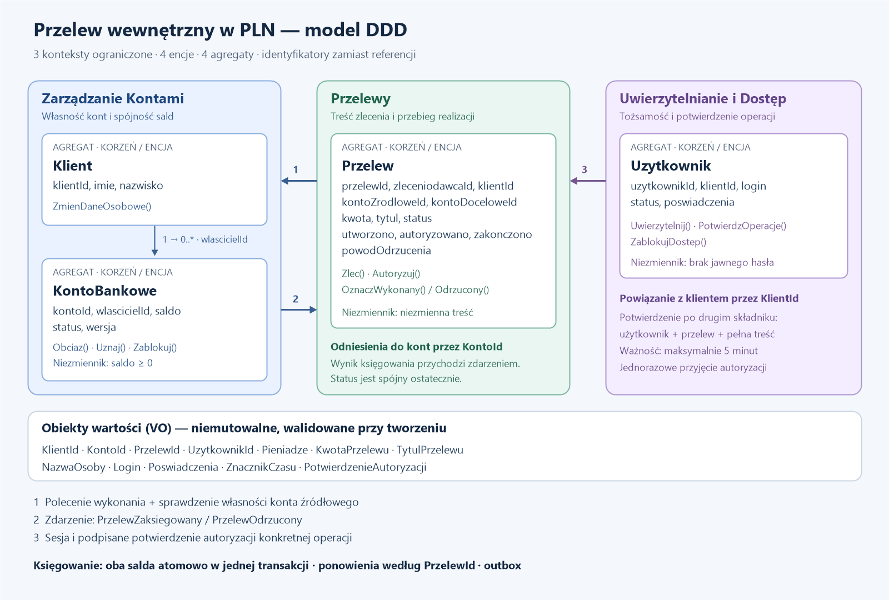

# Zadanie 1 — Domain Driven Design

Model przedstawia bezpieczne zlecanie i wykonywanie przelewów w PLN między kontami prowadzonymi w tym samym banku. System podzielono na trzy konteksty ograniczone: Zarządzanie Kontami, Przelewy oraz Uwierzytelnianie i Dostęp. Wyróżniono cztery encje będące korzeniami osobnych agregatów oraz obiekty wartości opisujące ich dane. Model skupia się na regułach domenowych, autoryzacji operacji i spójności sald.

## Model domenowy

Każdy prostokąt oznaczony jako agregat zawiera jedną encję — swój korzeń. Powiązania między agregatami wykorzystują identyfikatory, a nie bezpośrednie referencje do obiektów. Obiekty wartości są niemutowalne, porównywane po zawartości i walidowane przy tworzeniu.

## Konteksty ograniczone (Bounded Contexts)

| Kontekst | Odpowiedzialność i własność danych | Integracja |
| --- | --- | --- |
| **Zarządzanie Kontami** | Agregaty `Klient` i `KontoBankowe`; dane klienta, własność kont, statusy i salda. Tylko ten kontekst zmienia salda. | Udostępnia operację `WykonajPrzelewWewnetrzny`. Publikuje `PrzelewZaksiegowany` albo `PrzelewOdrzucony`. |
| **Przelewy** | Agregat `Przelew`; niezmienna treść zlecenia, jego autoryzacja i stan realizacji. | Przyjmuje zlecenie użytkownika, sprawdza potwierdzenie autoryzacji i przekazuje polecenie wykonania do Zarządzania Kontami. Odbiera wynik. |
| **Uwierzytelnianie i Dostęp** | Agregat `Uzytkownik`; powiązanie tożsamości z klientem, dostęp do systemu i potwierdzenie operacji drugim składnikiem. | Wydaje sesję oraz krótkotrwałe potwierdzenie autoryzacji konkretnego przelewu. Nie ustala własności konta i nie modyfikuje salda. |

`Klient` oznacza właściciela kont w kontekście kont, a `Uzytkownik` — tożsamość używaną do logowania w kontekście dostępu. Są to odrębne pojęcia, połączone przez `klientId`. Granice kontekstów nie wymagają wdrażania osobnych mikroserwisów.

## Agregaty i encje

Łącznie model zawiera **4 encje i 4 agregaty**. Każdy korzeń kontroluje zmiany swojego stanu; pola nie mają publicznych setterów.

| Agregat / encja | Atrybuty | Operacje i reguły |
| --- | --- | --- |
| **Klient** | `klientId: KlientId`, `imie: NazwaOsoby`, `nazwisko: NazwaOsoby` | `ZmienDaneOsobowe` przyjmuje wyłącznie poprawne obiekty wartości. Klient może mieć wiele kont. Rejestracja i weryfikacja klienta są poza zakresem; korzystamy z już zweryfikowanych klientów. |
| **KontoBankowe** | `kontoId: KontoId`, `wlascicielId: KlientId`, `saldo: Pieniadze`, `status: AKTYWNE / ZABLOKOWANE`, `wersja: integer >= 0` | `Obciaz`, `Uznaj`, `Zablokuj`, `Odblokuj`. Konto ma dokładnie jednego właściciela. Saldo nie może być ujemne ani przekroczyć ustalonego maksimum. Obciążenie i uznanie w przelewie są dostępne wyłącznie przez usługę domenową wykonującą całą operację. |
| **Przelew** | `przelewId: PrzelewId`, `zleceniodawcaId: UzytkownikId`, `klientId: KlientId`, `kontoZrodloweId: KontoId`, `kontoDoceloweId: KontoId`, `kwota: KwotaPrzelewu`, `tytul: TytulPrzelewu`, `status`, `utworzono: ZnacznikCzasu`, `autoryzowano: ZnacznikCzasu?`, `zakonczono: ZnacznikCzasu?`, `powodOdrzucenia: KodOdrzucenia?` | `Zlec`, `Autoryzuj`, `OznaczWykonany`, `OznaczOdrzucony`. Konta muszą być różne. Treść i uczestnicy zlecenia są niezmienni od utworzenia. Zmiana danych wymaga nowego zlecenia i nowej autoryzacji. |
| **Uzytkownik** | `uzytkownikId: UzytkownikId`, `klientId: KlientId`, `login: Login`, `status: AKTYWNY / ZABLOKOWANY`, `poswiadczenia: Poswiadczenia` | `Uwierzytelnij`, `PotwierdzOperacje`, `ZablokujDostep`. W tym modelu klient ma dokładnie jednego użytkownika. Tylko aktywny użytkownik może rozpocząć sesję i potwierdzić przelew. |

## Obiekty wartości i formaty danych

Wszystkie ograniczenia poniżej to założenia tego ćwiczenia, a nie pełny zestaw wymagań dla systemu bankowego.

| Obiekt wartości / typ | Atrybuty i akceptowany format | Ograniczenia |
| --- | --- | --- |
| `KlientId`, `KontoId`, `PrzelewId`, `UzytkownikId` | Osobne typy opakowujące UUID v4, np. `550e8400-e29b-41d4-a716-446655440000`. | Wymagane, generowane przez serwer, niezmienne. Jeden typ identyfikatora nie zastępuje innego. Identyfikatory kont wystarczają do przelewów wewnętrznych; numeracja NRB/IBAN jest poza zakresem. |
| `Pieniadze` | `grosze: int64`, `waluta: PLN`; na granicy API zapis dziesiętny jako tekst, np. `"1250.50"`. | Saldo: od `0.00` do `9999999999.99` PLN. Wejście: cyfry, kropka i dokładnie dwie cyfry części ułamkowej; bez znaku, separatorów tysięcy i notacji wykładniczej. Brak typów zmiennoprzecinkowych i automatycznego zaokrąglania. |
| `KwotaPrzelewu` | `wartosc: Pieniadze`. | Od `0.01` do `1000000.00` PLN włącznie. Waluta obu kont i przelewu musi być identyczna. Limit dotyczy pojedynczego przelewu; limity dzienne są poza zakresem. |
| `NazwaOsoby` | Tekst Unicode w normalizacji NFC, po usunięciu skrajnych spacji. | 1–100 znaków; litery, znaki łączące, pojedyncze spacje, apostrof i łącznik; wymagane co najmniej jedno wystąpienie litery. Bez znaków sterujących. |
| `TytulPrzelewu` | Tekst Unicode NFC po usunięciu skrajnych spacji. | 1–140 znaków, bez znaków sterujących i nowych linii. Tytuł jest zwykłym tekstem; przy prezentacji stosuje się kodowanie właściwe dla miejsca wyświetlenia. |
| `Login` | 3–64 znaki ASCII: małe litery, cyfry, `.`, `_`, `-`. | Unikalny w kontekście dostępu. Przy przyjęciu zamieniany na małe litery; inne znaki są odrzucane. |
| `Poswiadczenia` | Weryfikator hasła z solą i parametrami funkcji haszującej oraz referencja do zarejestrowanego drugiego składnika. | Bez jawnego hasła w encji, logach i zdarzeniach. Sekrety drugiego składnika przechowuje chroniona infrastruktura kontekstu dostępu. |
| `ZnacznikCzasu` | Czas ustalany przez serwer, ISO 8601 w UTC, np. `2026-11-11T10:15:30Z`. | `utworzono <= autoryzowano <= zakonczono`, jeśli dane pola występują. Odrzucenie przed autoryzacją nie ustawia pola `autoryzowano`. |
| `PotwierdzenieAutoryzacji` | Podpisany komunikat: `potwierdzenieId: UUID`, identyfikatory użytkownika, klienta i przelewu, oba konta, kwota, waluta, tytuł, czas wydania i wygaśnięcia. | Wydawany po potwierdzeniu drugim składnikiem, ważny maksymalnie 5 minut. Przelewy weryfikują podpis, wystawcę, odbiorcę, czas ważności i zgodność wszystkich danych ze zleceniem. Identyfikator jest zużywany atomowo przy przyjęciu autoryzacji. |
| `StatusPrzelewu` / `KodOdrzucenia` | Status: `OCZEKUJE_NA_AUTORYZACJE`, `PRZYJETY`, `WYKONANY`, `ODRZUCONY`. Powód: `BRAK_SRODKOW`, `KONTO_NIEDOSTEPNE`, `BRAK_UPRAWNIEN`, `PRZEKROCZENIE_SALDA`, `WYGASLA_AUTORYZACJA`. | Zamknięte zbiory wartości. Powód jest wymagany wyłącznie dla odrzuconego przelewu. Szczegóły kont osób trzecich nie trafiają do odpowiedzi dla użytkownika. |

## Założenia biznesowe i bezpieczeństwa

| Obszar | Przyjęte założenie |
| --- | --- |
| Zakres | Przelewy natychmiastowe między istniejącymi kontami w tym samym banku, wyłącznie PLN. Bez prowizji, kredytu, przewalutowań, przelewów zewnętrznych, współwłasności i pełnomocnictw. Początkowe salda pochodzą z wcześniejszych operacji, których ten fragment nie modeluje. |
| Tożsamość i uprawnienia | Serwer ustala `uzytkownikId` i `klientId` na podstawie ważnej sesji, bez zaufania do wartości podanych przez klienta API. Właściciel konta źródłowego musi odpowiadać temu klientowi; weryfikacja następuje przy zlecaniu oraz ponownie przy księgowaniu. Uznanie aktywnego konta odbiorcy nie wymaga zgody jego właściciela. |
| Stan kont | W momencie księgowania oba konta muszą istnieć i być aktywne. Blokada konta uniemożliwia zarówno obciążenie, jak i uznanie w tym uproszczonym modelu. |
| Autoryzacja | Każdy przelew wymaga drugiego składnika i potwierdzenia powiązanego z jego pełną treścią. Nie można zaakceptować potwierdzenia dotyczącego innego użytkownika, konta, tytułu lub kwoty. Wygaśnięcie przed przyjęciem autoryzacji kończy zlecenie odrzuceniem; błędne potwierdzenie jest odrzucane bez zmiany stanu przelewu. |
| Dane i dostęp techniczny | Komunikacja jest szyfrowana, interfejsy wewnętrzne wymagają uwierzytelnienia usługi, a uprawnienia do odczytu i zapisu są ograniczone do odpowiedniego kontekstu. Parametry zapytań nie są składane z surowego tekstu użytkownika. |
| Audyt | Rejestrowane są identyfikator przelewu i aktora, operacja, czas i wynik. Dziennik ma ograniczony dostęp i ochronę przed modyfikacją. Nie zapisuje haseł, tokenów, sekretów drugiego składnika ani pełnego tytułu przelewu. |

## Operacje i współpraca kontekstów

1. **Zlecenie:** uwierzytelniony użytkownik podaje konto źródłowe, konto docelowe, kwotę i tytuł. Przelewy sprawdzają własność konta źródłowego przez API Zarządzania Kontami, walidują dane i tworzą `Przelew` w stanie `OCZEKUJE_NA_AUTORYZACJE`. Utworzenie zlecenia nie rezerwuje środków.
2. **Potwierdzenie:** Uwierzytelnianie i Dostęp pobiera utrwaloną treść zlecenia przez zaufany interfejs, przedstawia ją użytkownikowi i po weryfikacji drugiego składnika wystawia `PotwierdzenieAutoryzacji`. Przelewy sprawdzają komunikat, atomowo zużywają jego identyfikator i ustawiają stan `PRZYJETY`. W tej samej lokalnej transakcji zapisują polecenie do skrzynki outbox.
3. **Księgowanie:** zaufany proces przekazuje `WykonajPrzelewWewnetrzny(przelewId, klientId, kontoZrodloweId, kontoDoceloweId, kwota)` do Zarządzania Kontami. Usługa domenowa ładuje oba agregaty `KontoBankowe` i ponownie sprawdza własność, statusy, dostępne środki i maksymalne saldo odbiorcy.
4. **Wspólna transakcja sald:** oba konta znajdują się w jednej bazie tego kontekstu. Usługa blokuje ich rekordy w stałej kolejności według identyfikatora i wykonuje obciążenie oraz uznanie w jednej transakcji ACID. Suma sald pozostaje niezmieniona; obie zmiany zatwierdzają się razem albo żadna. Jest to świadomy wyjątek od preferencji jednej transakcji na agregat, uzasadniony natychmiastowym przelewem wewnętrznym; nie łączy kont na stałe w jeden agregat.
5. **Wynik:** Zarządzanie Kontami zapisuje wynik i zdarzenie w swoim outboxie w tej samej transakcji co zmiany sald. Przy niespełnieniu reguły biznesowej zapisuje odrzucenie bez zmiany sald. Przelewy przetwarzają zdarzenie `PrzelewZaksiegowany` lub `PrzelewOdrzucony` i ustawiają stan końcowy wraz z czasem zakończenia.

### Spójność, ponowienia i stan przelewu

- **Przejścia stanów:** `OCZEKUJE_NA_AUTORYZACJE → PRZYJETY → WYKONANY / ODRZUCONY`. Zlecenie oczekujące może również przejść bezpośrednio do `ODRZUCONY` po wygaśnięciu autoryzacji. Stany końcowe są nieodwracalne; w modelu nie ma anulowania przyjętego przelewu.
- **Idempotencja:** każda próba utworzenia zlecenia zawiera klucz UUID v4, unikalny w obrębie użytkownika. Ponowienie z tym samym kluczem i treścią zwraca istniejący przelew; inna treść z tym kluczem jest odrzucana. Klucz i utworzenie zlecenia są zapisywane atomowo. Ponowiona autoryzacja już przyjętego zlecenia zwraca jego bieżący stan bez ponownego zużycia potwierdzenia.
- **Ochrona księgowania:** Zarządzanie Kontami przechowuje trwały wynik operacji pod unikalnym `przelewId`, razem z parametrami polecenia. Wpis powstaje atomowo ze zmianą sald i outboxem. Powtórzone polecenie z identycznymi parametrami zwraca zapisany wynik; inne parametry dla tego samego identyfikatora są odrzucane. Równoległe duplikaty rozstrzyga ograniczenie unikalności i transakcja.
- **Awaria techniczna:** timeout lub brak dostarczenia zdarzenia nie oznacza biznesowego odrzucenia. Przelew pozostaje `PRZYJETY`; polecenie lub zdarzenie jest ponawiane. Sprawdzenie terminu ważności potwierdzenia dotyczy chwili przyjęcia autoryzacji — późniejsze ponowienie przyjętego polecenia nie wymaga ponownej autoryzacji.
- **Granice spójności:** salda są spójne natychmiast w Zarządzaniu Kontami, natomiast status w Przelewach jest spójny ostatecznie. Przez krótki czas zaksięgowany przelew może być widoczny jako `PRZYJETY`. Odbiorcy zdarzeń ignorują duplikaty i nie cofają stanów końcowych.
- **Elementy techniczne:** outbox, rejestr wykonanych poleceń, klucze idempotencji, sesje i dziennik audytu są mechanizmami infrastruktury, a nie dodatkowymi encjami domenowymi tego modelu.
