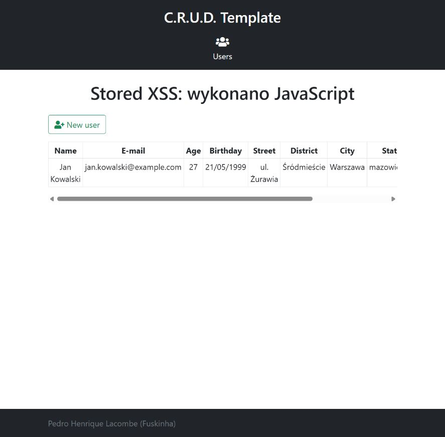
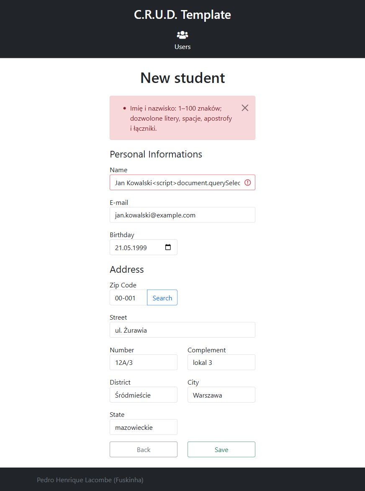
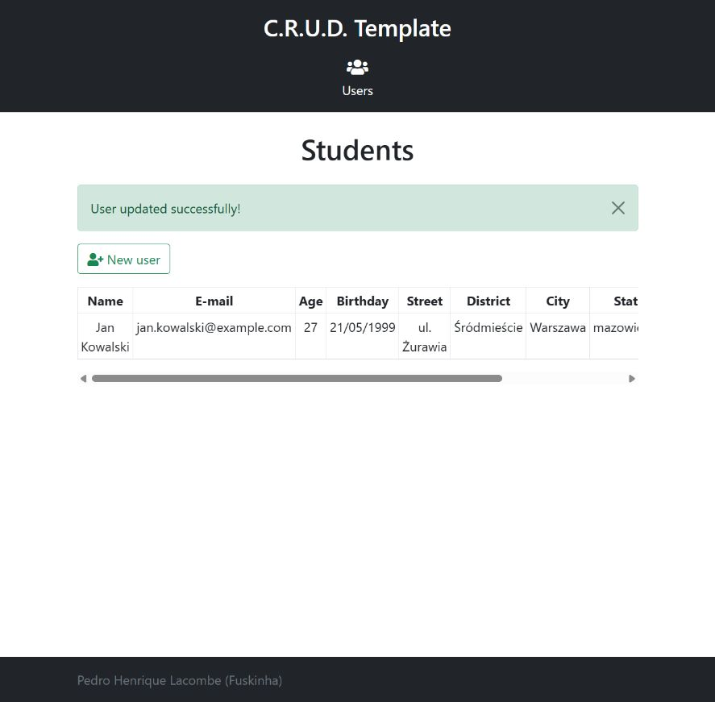

# Stored XSS w aplikacji Java — opis i poprawka

## Zakres

Sprawdzono aplikację Spring Boot z katalogu `Java/spring-thymeleaf-crud-example`. Scenariusz dotyczy zapisania kodu JavaScript w danych studenta i jego wykonania przy późniejszym wyświetleniu listy studentów. Poprawka obejmuje walidację danych w backendzie podczas tworzenia i modyfikowania obiektów oraz bezpieczne wyświetlanie istniejących danych.

## Przyczyna podatności

Formularz `GET /students/new` wysyła dane do `POST /students/new`. Kontroler waliduje `CreateStudentDTO`, mapper tworzy encje `Student` i `Address`, a serwis zapisuje je w bazie H2. W pierwotnej wersji większość pól miała jedynie `@NotEmpty`: znacznik `<script>` również jest niepustą wartością i przechodził taką walidację.

Szablon `src/main/resources/templates/students.html` wyświetlał dane użytkownika przez `th:utext`, między innymi:

```html
<td th:utext="${student.name}">Name</td>
```

Wartość trafiała do dokumentu jako HTML, przez co przeglądarka mogła wykonać zapisany skrypt. Analogiczne ujścia dotyczyły ulicy, dzielnicy, miasta, regionu i adresu e-mail. Ścieżka edycji `POST /students/{id}` korzystała z tego samego mappera i również wymagała ochrony.

## Dane przykładowe

Wszystkie poniższe dane są fikcyjne, a adres e-mail korzysta z domeny przykładowej.

| Pole formularza | Wartość |
| --- | --- |
| Name | `Jan Kowalski` |
| E-mail | `jan.kowalski@example.com` |
| Birthday | `1999-05-21` |
| Zip Code | `00-001` |
| Street | `ul. Żurawia` |
| Number | `12A/3` |
| Complement | `lokal 3` |
| District | `Śródmieście` |
| City | `Warszawa` |
| State | `mazowieckie` |

## Odtworzenie w pierwotnej wersji

1. Uruchom oryginalną aplikację i otwórz `http://localhost:8080/students/new`.
2. Uzupełnij formularz danymi z tabeli, zmieniając `Name` na:

   ```html
   Jan Kowalski<script>document.querySelector('h1').textContent='Stored XSS: wykonano JavaScript';alert('Stored XSS')</script>
   ```

3. Zapisz formularz. Po przekierowaniu na `/students` przeglądarka wykonuje skrypt, zmienia nagłówek na `Stored XSS: wykonano JavaScript` i pokazuje alert `Stored XSS`.
4. Zamknij alert, a następnie ponownie otwórz `/students` bez wysyłania formularza. Ponowne wykonanie skryptu potwierdza, że dane odczytano z bazy, a problem ma charakter stored XSS.

Pierwotna maska kodu pocztowego w przeglądarce dopuszczała tylko brazylijski format `00000-000`. Przy odtwarzaniu z polskim adresem można wysłać formularz bezpośrednim żądaniem POST, jak poniżej. Oryginalny backend akceptuje polski kod, mimo ograniczenia samej maski. Poprawiona wersja formularza obsługuje oba formaty bez tej maski.

```powershell
$form = @{
    name = "Jan Kowalski<script>document.querySelector('h1').textContent='Stored XSS: wykonano JavaScript';alert('Stored XSS')</script>"
    email = 'jan.kowalski@example.com'
    birthday = '1999-05-21'
    zipCode = '00-001'
    street = 'ul. Żurawia'
    number = '12A/3'
    complement = 'lokal 3'
    district = 'Śródmieście'
    city = 'Warszawa'
    state = 'mazowieckie'
}
Invoke-WebRequest -Uri 'http://localhost:8080/students/new' `
    -Method Post -Body $form `
    -ContentType 'application/x-www-form-urlencoded; charset=UTF-8'
```

Następnie otwórz `/students` w przeglądarce, która wykona JavaScript. Sam klient HTTP nie wykonuje skryptów i nie stanowi dowodu ich wykonania.

H2 jest skonfigurowana jako baza w pamięci (`jdbc:h2:mem:thymeleafdb`). Wpis istnieje podczas kolejnych odczytów w tym samym uruchomieniu aplikacji, ale znika po jej restarcie.

## Wynik próby w przeglądarce — 12 listopada 2026

Wersję podatną uruchomiono na `localhost:8081`, a poprawioną na `localhost:8080`. Kod oryginalnej aplikacji pochodził ze stanu `3a2d955a8a7108128321d2bb11ebf917d7a350a1`; w jej kopii zmieniono tylko środowisko Docker potrzebne do uruchomienia. Nie dodano do niej walidacji ani nie zmieniono szablonów.

Wypełnienie pierwotnego formularza potwierdziło, że maska zamienia polski kod na `00001`. Aby zachować polskie dane, właściwy zapis wykonano żądaniem POST z `00-001`, a następnie odczytano listę w przeglądarce. Zapisany skrypt zmienił nagłówek listy. Po ponownym wczytaniu strony wystąpił alert JavaScript, a nagłówek ponownie zmienił treść.

Poniższy zrzut pokazuje nagłówek zmieniony przez zapisany skrypt. Jest to widoczny dowód jego wykonania; sam szablon aplikacji w tym miejscu zawierał `Students`.



W poprawionej aplikacji ten sam payload wysłano przyciskiem `Save` w formularzu. Backend zwrócił formularz z błędem pola `name`; alert JavaScript nie wystąpił. Następny odczyt listy pokazał wyłącznie istniejący poprawny rekord Jana Kowalskiego, bez dodatkowego wpisu z payloadem.



Dodatkowo sprawdzono poprawną edycję danych przykładowego studenta: zapisano nazwę `Jan Kowalski` i adres `jan.kowalski@example.com`, pozostawiając pozostałe dane z tabeli. Aplikacja pokazała komunikat powodzenia i prawidłowo wyświetliła polskie znaki w adresie.



Po sprawdzeniu zatrzymano testowy kontener wersji podatnej. Poprawiona aplikacja pozostała uruchomiona na `http://localhost:8080/students`.

## Założenia walidacji

Pola przechowują zwykły tekst; aplikacja nie obsługuje HTML w danych studenta. Niepoprawna wartość jest odrzucana, bez automatycznego usuwania fragmentów i bez zapisywania zakodowanego HTML w bazie. Reguły są listami dozwolonych znaków właściwymi dla poszczególnych pól.

| Pole | Reguła backendowa |
| --- | --- |
| Imię i nazwisko | 1–100 jednostek UTF-16; litery Unicode, znaki łączące, spacje, apostrofy `'` i `’`, łącznik; co najmniej jedna litera. |
| E-mail | Do 254 znaków ASCII, część lokalna do 64 znaków; litery, cyfry, `_`, `%`, `+`, `-` i kropki rozdzielające niepuste segmenty; domena z co najmniej jedną kropką i etykietami do 63 znaków. Obsługiwany jest ten uproszczony podzbiór adresów, bez cudzysłowów i domen Unicode. |
| Kod pocztowy | `00-001` albo oryginalny format `01001-000`; wyłącznie cyfry ASCII i łącznik. |
| Ulica | 1–150 jednostek UTF-16; litery, znaki łączące, cyfry Unicode, spacje i znaki `. , ' ’ / ( ) -`; wymagana litera lub cyfra. |
| Numer budynku | 1–20 jednostek UTF-16; zaczyna się literą lub cyfrą; dozwolone litery, cyfry, spacje, `/`, `.`, `-`. |
| Uzupełnienie adresu | Opcjonalne (`null` lub pusty tekst); do 150 jednostek UTF-16; dla niepustej wartości reguły jak dla ulicy. |
| Dzielnica, miasto, region | Każde 1–100 jednostek UTF-16; znaki jak dla ulicy. |
| Data urodzenia | Wymagana poprawna data ISO `yyyy-MM-dd`, wcześniejsza niż bieżący dzień serwera. |

Listy znaków tekstowych nie dopuszczają znaczników HTML, encji rozpoczynanych znakiem `&`, nowych linii ani znaków sterujących. Reguły nie są pełnym modelem wszystkich nazw osobowych, adresów i adresów e-mail na świecie; określają obsługiwany zakres tej aplikacji.

## Implementacja

- `StudentFieldType` definiuje wspólne reguły i limity.
- Adnotacja `@StudentField` i `StudentFieldValidator` stosują te reguły w `CreateStudentDTO`. `UpdateStudentDTO` dziedziczy ograniczenia, więc obejmują one również edycję. Istniejące `@Valid` i `BindingResult` zatrzymują błędne żądanie przed mapperem i zapisem; formularz pokazuje komunikat przypisany do pola.
- Jawne settery encji `Student` i `Address` wywołują te same reguły przed przypisaniem danych. Dzięki temu samo pominięcie kontrolera lub `@Valid` i bezpośrednie użycie `StudentMapper.toEntity()` nie umożliwia utworzenia encji z payloadem. W takim wywołaniu niepoprawna wartość powoduje `IllegalArgumentException`.
- `@Past` oraz setter daty urodzenia odrzucają brak daty, dzień bieżący i przyszłość.
- `students.html` używa `th:text`. Jest to dodatkowa ochrona istniejących rekordów, a nie zastępstwo wymaganej walidacji przy tworzeniu obiektów.
- Formularze przyjmują polski kod pocztowy; pozostawiono obsługę oryginalnego formatu brazylijskiego. Wyszukiwarka adresów pozostaje usługą brazylijską i nie jest potrzebna do ręcznego wprowadzenia polskiego adresu.

JPA korzysta z dostępu do pól, więc odczyt historycznego rekordu z bazy nie uruchamia setterów. Dlatego bezpieczne wyświetlanie jest potrzebne również po dodaniu walidacji. Bezpośrednie zapisy SQL i modyfikacje bazy poza aplikacją nie są chronione przez walidator Java.

## Uruchamianie poprawionej aplikacji

Z głównego katalogu repozytorium:

```powershell
cd Java/spring-thymeleaf-crud-example
docker build -t task1-java .
docker run --rm --name task1-java -p 127.0.0.1:8080:8080 task1-java
```

Budowanie pakuje aplikację poleceniem `mvn -B clean install -DskipTests`. Zastąpiono niedostępny obraz `openjdk:11-jdk-slim` obrazem `eclipse-temurin:11-jre-jammy`, a etap budowania korzysta z `maven:3.9-eclipse-temurin-11`. Wersja języka projektu pozostaje Java 11. Zależności Maven są pobierane w osobnej warstwie przed skopiowaniem kodu, co pozwala wykorzystać cache przy kolejnych budowaniach.

Jeżeli lokalne skanowanie HTTPS podpisuje połączenia własnym certyfikatem CA (na sprawdzanej maszynie robił to Norton), Java wewnątrz kontenera może zgłosić `PKIX path building failed`. Dockerfile obsługuje opcjonalny sekret `maven_ca`: należy przekazać publiczny certyfikat CA zweryfikowany i zaufany w systemie, w formacie PEM lub DER. Nie należy przekazywać klucza prywatnego ani wyłączać sprawdzania TLS.

```powershell
docker build --secret id=maven_ca,src=C:/certificates/maven-ca.pem `
    --build-arg 'MAVEN_OPTS=-Djdk.tls.client.protocols=TLSv1.2 -Dhttps.protocols=TLSv1.2 -Djava.net.preferIPv4Stack=true' `
    -t task1-java .
```

Certyfikat jest importowany wyłącznie do magazynu Javy etapu budowania. Nie jest kopiowany do obrazu uruchomieniowego aplikacji. Powyższe ustawienia TLS 1.2 i IPv4 pozwoliły również rozwiązać błąd uzgadniania połączenia ze skanerem HTTPS na sprawdzanej maszynie. W środowisku bez takiego pośrednika te opcje nie są potrzebne.

Po poprawce ten sam payload powinien spowodować błąd walidacji w formularzu i nie powinien zostać zapisany. Poprawne dane z tabeli należy móc zapisać oraz edytować.

## Materiały źródłowe

- [Thymeleaf — Unescaped Text](https://www.thymeleaf.org/doc/tutorials/3.0/usingthymeleaf.html#unescaped-text).
- [OWASP — Input Validation Cheat Sheet](https://cheatsheetseries.owasp.org/cheatsheets/Input_Validation_Cheat_Sheet.html).
- [OWASP — Cross Site Scripting Prevention Cheat Sheet](https://cheatsheetseries.owasp.org/cheatsheets/Cross_Site_Scripting_Prevention_Cheat_Sheet.html).
- Oficjalne obrazy [Maven](https://hub.docker.com/_/maven) i [Eclipse Temurin](https://hub.docker.com/_/eclipse-temurin).
